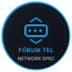
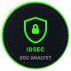

 

&nbsp;

  

Analista de Sistemas de TI Pleno. Construo e sustento infraestrutura de missão crítica: redes e firewalls, servidores e virtualização, cloud, monitoramento e SOC. Gosto de transformar rotina de TI em ferramenta aberta.

## Projetos

<table>
  <tr>
    <td valign="top" width="33%">
      

      
<b><a href="https://github.com/targino-tech/malha">Malha</a></b> inventário de rede e ativos para o agro · open source

      
      ▸ coletor Go somente leitura no UniFi 
      ▸ alerta em 3 min quando a fazenda cai 
      ▸ Zabbix e Grafana montados do inventário 
      ▸ login Entra ID, AD/LDAP ou OIDC
      
      
  

      
<a href="https://targino-tech.github.io/malha/">site</a> · <a href="https://targino-tech.github.io/malha/video/">vídeo</a> · <a href="https://github.com/targino-tech/malha">código</a>

    </td>
    <td valign="top" width="33%">
      

      
<b><a href="https://github.com/targino-tech/Motiroramento-T.I-">NOC Master 360°</a></b> monitoramento de TI · NOC em Docker

      
      ▸ visão geral e 5 painéis dedicados 
      ▸ WAN, Wi-Fi UniFi, servidores, impressoras e VoIP 
      ▸ alertas no Telegram e acesso por túnel 
      ▸ runbook de atendimento versionado
      
      
  

      
<a href="https://github.com/targino-tech/Motiroramento-T.I-">código</a>

    </td>
    <td valign="top" width="33%">
      

      
<b>Central TI</b> API de inventário, monitoramento e integrações

      
      ▸ agente PowerShell para PCs Windows 
      ▸ UniFi, Google Admin, AD (LDAPS) e Cloudflare 
      ▸ SNMP somente leitura em impressoras 
      ▸ alertas por limite, perfis e auditoria
      
      
  

      
repositório privado

    </td>
  </tr>
</table>

## Stack

  

  
  
  
  
  
  
  
  

## Certificações

<table>
  <tr>
    <td align="center" valign="top" width="25%">
       
      <b>Gemini Certified University Student</b> 
      Google for Education 
      <code>Ago 2026 · válido até 2029</code> 
      191927503
    </td>
    <td align="center" valign="top" width="25%">
       
      <b>Analista de Redes</b> 
      Fórum Telecom 
      <code>Jun 2026</code> 
      VMware · MikroTik · BGP
    </td>
    <td align="center" valign="top" width="25%">
       
      <b>AWS Security Best Practices</b> 
      Amazon Web Services 
      <code>Mai 2026</code> 
      cfc0df39…a08f
    </td>
    <td align="center" valign="top" width="25%">
       
      <b>Threat Landscape 3.0 · NSE 1</b> 
      Fortinet 
      <code>Mai 2026</code> 
      Fortinet Training Institute
    </td>
  </tr>
  <tr>
    <td align="center" valign="top" width="25%">
       
      <b>Riachuelo Cibersegurança</b> 
      DIO · Riachuelo 
      <code>Fev 2026</code> 
      1C71FUIK
    </td>
    <td align="center" valign="top" width="25%">
       
      <b>Azure AI Essentials</b> 
      Microsoft · LinkedIn 
      <code>Jan 2026</code> 
      Certificado profissional
    </td>
    <td align="center" valign="top" width="25%">
       
      <b>Networking Basics</b> 
      Cisco Networking Academy 
      <code>Out 2025</code> 
      Credly verified
    </td>
    <td align="center" valign="top" width="25%">
       
      <b>Analista de SOC</b> 
      IDsec 
      <code>2025 · 2026</code> 
      Defesa e segurança cibernética
    </td>
  </tr>
</table>

## Atividade

  
  

