<h1 align="left">
  
</h1>

> **Analista de Sistemas de TI Pleno & Infraestrutura.** Especialista em Infraestrutura de Redes, Cloud, Segurança e Observabilidade. Focado na arquitetura, sustentação e proteção de ambientes corporativos de missão crítica — desde redes físicas e firewalls (FortiGate, Sophos, MikroTik, Cisco) até cloud (AWS), virtualização de servidores (Proxmox, VMware), observabilidade (Zabbix, Grafana) e operações de SOC.

  
  
  

  
  
  
  
  

## 🛠️ Tecnologias & Ferramentas

  

  
  
  
  
  
  
  
  

## 🎖️ Certificações

  
  
  
  
  
  <a href="https://idsec.com.br/" title="Analista de SOC - IDsec">
    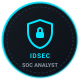
  </a>
  <a href="https://forumtelecom.com.br/" title="Analista de Redes - Fórum Telecom">
    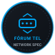
  </a>
  

📋 <b>Ver credenciais detalhadas</b>

 

| Certificação | Emissor | Conclusão / Validade | Código / Credencial |
| :--- | :--- | :--- | :--- |
| **Estudante Universitário Certificado Gemini** | Google for Education | Ago 2026 – Ago 2029 | `191927503` |
| **Analista de Redes** *(VMware, MikroTik, BGP)* | Fórum Telecom | Jun 2026 | *Fundamentos e Roteamento Avançado* |
| **AWS Security Best Practices: Overview** | Amazon Web Services (AWS) | Mai 2026 | `cfc0df39-01b1-4eb4-ab90-d3735101a08f` |
| **Introduction to the Threat Landscape 3.0** | Fortinet (NSE 1) | Mai 2026 | *Fortinet Training Institute* |
| **Riachuelo Cibersegurança** | DIO / Riachuelo | Fev 2026 | `1C71FUIK` |
| **Microsoft Azure AI Essentials** | Microsoft & LinkedIn | Jan 2026 | *Certificado Profissional* |
| **Networking Basics** | Cisco Networking Academy | Out 2025 | *Credly Verified* |
| **Analista de SOC** | IDsec | 2025 / 2026 | *Instituto de Defesa e Segurança Cibernética* |

## 🚀 Projetos em destaque

  <a href="https://github.com/targino-tech/cups-root-intelligence" title="CUPS Root Intelligence">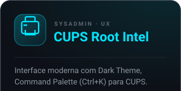</a>
  <a href="https://github.com/lucasmarujo/orkai-cli/pull/4" title="Orkai CLI (Contribuição pt-BR)">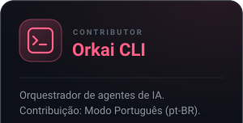</a>
  <a href="https://github.com/targino-tech" title="Infra & SOC Lab">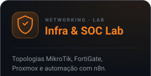</a>
   
  <a href="https://github.com/targino-tech/cups-root-intelligence" title="Repositório">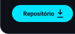</a><a href="https://github.com/targino-tech/cups-root-intelligence#readme" title="Ver Projeto">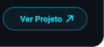</a>
  <a href="https://github.com/lucasmarujo/orkai-cli/pull/4" title="Ver PR">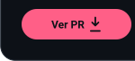</a><a href="https://github.com/lucasmarujo/orkai-cli" title="Orkai Repo">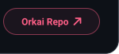</a>
  <a href="https://github.com/targino-tech" title="Ver Stack">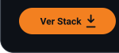</a><a href="https://github.com/targino-tech" title="Detalhes">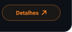</a>

---

  

